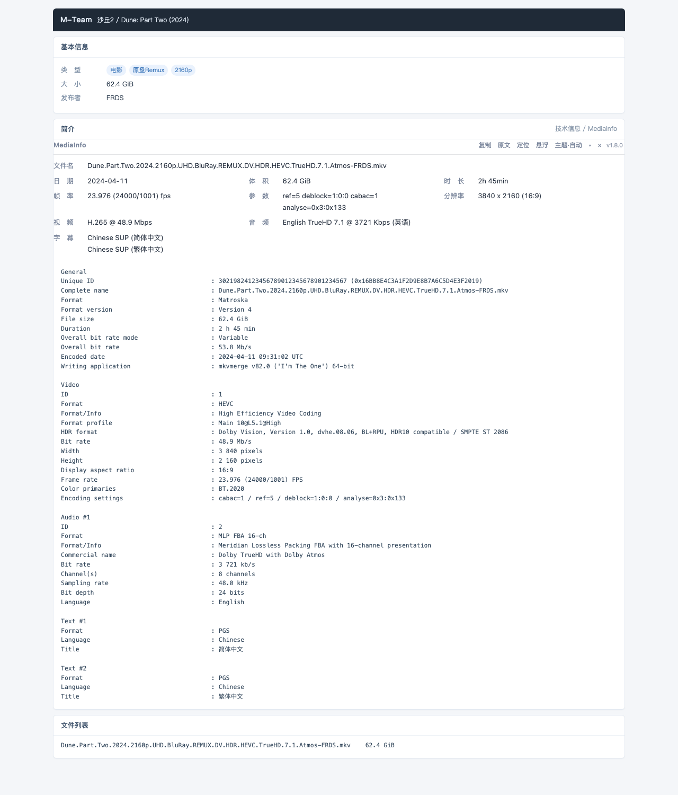

# MediaInfo 媒体信息卡片

把 PT 种子详情页里那一大坨 MediaInfo 英文原文、以及原盘的 BDInfo 碟报，自动整理成和站点同款的「媒体信息」行——一眼看清码率、分辨率、音轨、字幕，还能一键复制成整理好的文本。

适用于 **16 个 PT 站**（HDChina / HDHome / HHanClub / OurBits / PTer / KeepFRDS / U2 / TLF / TTG / CHDBits / M-Team / FileList / HTPT / BTN 等；另有 2 站按站方要求不在下面清单里点名，同样适配），Tampermonkey / Violentmonkey 均可。


> 上图：原盘 BDInfo 被包在「引用」框里、一行一个 `<div>`、空格写成 `&nbsp;`，卡片照样能读出碟名、体积、播放列表、时长、码率与每条音轨 / 字幕，并作为独立一行落在「简介」上方。

## 它做什么

脚本会自动找到页面上的 MediaInfo 或 BDInfo（**包括 `display:none` 折叠起来的、`<textarea>` 里的、用 `<br>` 逐行排版的、被塞进同源 iframe / shadow root 的**），解析成结构化字段，作为独立一行插在「简介」上方，不必展开简介也能看到：

- **位置**：表格里独立的一行，左侧有和「字幕」「简介」同款的「媒体信息」标签格
- **样式**：没有白底卡片、没有阴影、没有彩色色条，字体 / 字号 / 正文色 / 字段名色 / 分隔线全部从站点自身样式采样，看起来就是站点原生的表格行
- **内容（重编码）**：文件名 / 日期 / 体积 / 时长 / 帧率 / 参数 / 分辨率 / 视频 / 音频 / 字幕
- **内容（原盘 BDInfo）**：碟名 / 标签 / 体积（正片·整盘）/ 播放列表 / 时长 / 总码率 / 帧率 / 分辨率 / 视频 / 音频 / 字幕（原盘只有 `Disc Label` 时，碟名直接用标签值，不会空着）
- 短字段并排、长字段独占一行，列数随可用宽度自适应

## 功能

| 功能 | 说明 |
| --- | --- |
| 自动识别 | 按内容特征打分判断，不依赖具体模板类名；折叠、隐藏、`textarea`、`<br>` 排版都能读取 |
| 两种源都认 | MediaInfo（重编码、WEB-DL）与原盘 BDInfo 碟报都能解析；BDInfo 的「一行一字段短格式」与「DISC INFO / PLAYLIST REPORT / VIDEO / AUDIO / SUBTITLES 分段长格式」都支持，换行被站点吞掉、整段粘成一行也能还原 |
| 单位换算 | `Disc Size` / `Size` 的字节数换算成 GiB 并区分「正片 / 整盘」，`Length` 的 `1:48:56.863` 转成 `1h 48min 56s`，`Protection` 并入播放列表（如 `00001.MPLS（AACS 加密）`） |
| 一键复制 | 输出「文件名／日期／体积／…／字幕」的纯文本（原盘为「碟名／标签／体积／播放列表／…」），可直接贴到论坛或聊天 |
| 融入站点 | 内嵌时从「简介」行采样字体、字号、正文色、次要色、边框色，深色站点自动跟随 |
| 悬浮 / 内嵌 | 默认智能选择，找不到「简介」行则右下角悬浮（可拖拽，位置会记住） |
| 多份切换 | 一页有多份 MediaInfo / BDInfo 时用 `‹ 1/2 ›` 切换 |
| 参数折叠 | 编码参数默认只显示关键项，可展开全部 |
| 字幕折叠 | 字幕超过 5 条时只列出中 / 英文字幕，其余收进「+ 更多（N）」；「复制」与「原文」始终完整 |
| 版本自检 | 每 24 小时问一次仓库里的脚本头，有新版本时版本号旁亮一个红点，点红点直接更新；查过的时间会记下来，不会每次开页面都联网 |
| 诊断 | 字段为空时点「复制诊断信息」，一次列出抓到的文本、页面标记与每个字段的解析结果 |
| 快捷键 | `Alt + M` 显示 / 隐藏 |

## 安装

**方式一：从 GitHub 安装（推荐，之后由本仓库更新）**

1. 浏览器装好 [Tampermonkey](https://www.tampermonkey.net/)；
2. 打开 [mediainfo-card.user.js](https://github.com/ljp801005-tech/mediainfo-card/blob/main/mediainfo-card.user.js)，点右上角 **Raw**，油猴会弹出安装页；
   也可以直接用这个地址：`https://raw.githubusercontent.com/ljp801005-tech/mediainfo-card/main/mediainfo-card.user.js`
3. 安装后打开任意种子详情页即可看到「媒体信息」行。

**方式二：从 Greasy Fork 安装**

[greasyfork.org/zh-CN/scripts/605024](https://greasyfork.org/zh-CN/scripts/605024)

> 两条渠道的内容一致，但**更新源跟着安装来源走**：从 GitHub 装的由本仓库 `@updateURL` 更新，从 Greasy Fork 装的由 Greasy Fork 更新。

## 更新机制

脚本自己也会盯着版本：

- 打开种子页约 2.5 秒后（避开首屏），向下面这个 `@updateURL` 要一次脚本头，只读 `@version` 那一行，不下载整份逻辑；
- 查到有新版本时，卡片右上角**版本号右侧亮一个 6px 小红点**，点它就是用油猴装新版（会跳到安装页确认）；没有新版就不显示红点；
- 查过的时间与结果存在油猴存储里（`mi_update`），**24 小时内不再联网**，换页面直接按上次结果把红点亮出来；
- 想立刻查：卡片「关于」面板里点「检查更新」，或油猴菜单里点「检查新版本」；
- 查询走 `GM_xmlhttpRequest`（不受页面 CSP 限制），拿不到就退回 `fetch`；查询失败只是不亮红点，并在「关于」里写明原因，不弹窗。

脚本元数据里已经写好：

```
// @updateURL    https://raw.githubusercontent.com/ljp801005-tech/mediainfo-card/main/mediainfo-card.user.js
// @downloadURL  https://raw.githubusercontent.com/ljp801005-tech/mediainfo-card/main/mediainfo-card.user.js
```

所以日常发版就是「改文件 → 递增 `@version` → push 到 `main`」：

1. Tampermonkey 默认每 24 小时检查一次更新，也可在扩展面板点「检查脚本更新」；油猴菜单里也有「检查更新」。
2. `raw.githubusercontent.com` 有几分钟 CDN 缓存，刚 push 完立刻检查可能仍拿旧文件，等几分钟再来。
3. 版本号必须递增，否则油猴认为没有更新（`@version` 是唯一判断依据）。

带 tag 的发布（可选，便于留档与直链下载）：

```bash
git tag v1.7.4 && git push origin v1.7.4
```

推送 tag 后 GitHub Actions 会自动创建 Release，并把 `mediainfo-card.user.js` 挂到附件里，可用固定地址下载：
`https://github.com/ljp801005-tech/mediainfo-card/releases/latest/download/mediainfo-card.user.js`

## 适用站点

`@match` 已放行下面这些站点（裸域与 `*.域` 都写了，子域也能用），并且排除 `/edit.php`、`/upload.php`、`/takeupload.php` 与 `action=edit/upload` 这类发种 / 编辑页——那几页要往输入框里贴原文，卡片会挡表单。

| 站点 | 域名 | 模板 | 卡片落位 |
| --- | --- | --- | --- |
| HDChina 瓷器 | `h***.org` | NexusPHP | 表格行（克隆「简介」行） |
| HDHome 家园 | `h***.org` | NexusPHP | 表格行 |
| HHanClub 憨憨 | `h***.net` | NexusPHP | 表格行（简介折叠则悬浮） |
| OurBits 我堡 | `o***.club` | NexusPHP | 表格行 |
| PTer 猫站 | `p***.net` | NexusPHP | 表格行 |
| KeepFRDS 朋友 | `k***.com` | NexusPHP | 表格行 |
| U2 分享园 | `d***.org` | NexusPHP | 表格行 |
| TLF | `e***.org` | NexusPHP | 表格行 |
| TTG | `t***.im` | NexusPHP | 表格行 |
| CHDBits | `p***.co` | NexusPHP | 表格行 |
| M-Team 馒头 | `m***.cc` | Angular + ng-zorro | 简介卡片前 / 卡片内（`.markdown-body`） |
| FileList | `f***.io` | 自有模板 | 简介面板前（`.panel-body`） |
| HTPT | `h***.cc` | NexusPHP | 表格行 |
| BTN 广播 | `b***.net` | Gazelle | 同款 `.box` 插在简介盒前（`.torrent_description`） |

> 表里 14 行是**公开列出**的站点，域名只留首字母与后缀、中间用 `***` 遮掉（如 `h***.org`；脚本 `@match` 里是完整地址）；同一个掩码可能对应不止一个站，认站看左列；另有 2 个站按站方要求不在这里点名，适配照旧——装上脚本打开它的种子页一样出卡片，诊断里的「站点」一行会显示它自己的名字。



> 上图：M-Team 这类没有表格行的站点，卡片落在「简介」区块里、原始 MediaInfo 之上，仍然沿用站点的字体与配色。

落位按站点模板分档，命中哪档都会写进诊断信息：
0. **Gazelle 板块**：BTN 这类 Gazelle 站，简介是一个 `div.box`（`.head` 标题条 + `.body` 正文），卡片就做成同款盒子（标题条写 Media Info）插在简介盒之前，宽度与站点其它板块一致；
1. **表格行**：找到「简介」所在的 `<tr>`，克隆它的标签格 + 内容格插一行，列宽、边框、背景全部沿用站点样式；
2. **简介区块前**：没有表格行时，找 ID / 类名像「简介 / 描述」的容器（含各站专属线索，如 M-Team 的 `.markdown-body`、FileList 的 `.panel-body`、BTN 的 `.torrent_description`），插在它前面；
3. **区块前**：都认不出时，从 MediaInfo 所在节点往上找第一个「有兄弟」的块级祖先，把卡片立成它前面的一段——这样卡片仍然贴着简介区，而不是被迫悬浮。

还有一种「没有原文」的情况：简介里贴的是工具渲染好的 HTML 面板（FileList 上的 PTGen 模板就是这种，只有 Video / Audio / Subtitle 三栏表格，整页找不到 `Complete name` / `General` 段头）。
脚本会把面板里的「标签 + 值」和「#1 + 轨道描述」反推回 MediaInfo 文本再解析：

- **落位**：卡片插在三栏面板的**共同容器之前**、整块占一行，宽度与正文一致（不会挤进 flex 栏里只占 Video 那一格）；
- **收起原文**：切到内嵌时整组三栏一起收，右边不会留下半截；
- **补字段**：面板里没有文件名 / 体积 / 日期，脚本按 DOM 相邻关系（`<b>Size</b><br>13.21 GB`、`<b>Uploaded at</b><br>13/11/2026`）和 tooltip 里的 `.mkv` 名补上，补缺不覆盖；
- **不抢原文**：候选里有真正的 `Video` / `General` 段时完全不启用这条兜底；解析下来一个媒体字段都没有时也不会渲染一屏「—」。
- **看得见**：内嵌卡片是透明的，落位后会**逐字段**实测文字色与页面底色的亮度差（跳过「—」占位），任一字段看不清就按页面底色反选主题；页面底色由「在页面上取几个点、逐层找背景色投票」实测，量不出来时按页面主文字色反推，仍不确定就给卡片自己上底色。
- **主题开关优先**：手动选了亮色 / 暗色时，站点配色只跟随字体、不改文字色；此时若透明卡片仍然读不出来（深色站点 + 亮色主题这种组合），就给卡片加一层与主题一致的不透明底色 —— 亮色=白底深字，暗色=深底浅字，绝不留「字和底一个色」。

改站点：① 头部补两行 `@match`（裸域 + `*.域`）；② `SITES` 里登记一行名字（诊断与「关于」面板会显示站点名）；③ 结构特殊时在该行的 `desc` 里补一条容器线索。容器完全认不出时，也可以往 `CONFIG.extraSelectors` 加选择器。

## 常用配置

脚本内 `CONFIG` 对象集中了可调项：

| 配置 | 默认 | 说明 |
| --- | --- | --- |
| `mode` | `auto` | `auto` 智能（简介可见则内嵌，折叠则悬浮）/ `float` / `inline` |
| `theme` | `auto` | 自动 / 亮色 / 暗色 |
| `followSiteStyle` | `true` | 内嵌时跟随站点配色 |
| `maxInfo` | `12` | 一页最多处理几份 |
| `paramLimit` | `8` | 「参数」默认显示几项 |
| `subtitleCollapseThreshold` | `5` | 字幕超过几条开始折叠（0 = 关闭） |
| `subtitleKeepLangs` | `['zh','en']` | 折叠时保留的语言组 |
| `excludePaths` | `/edit.php`、`/upload.php`、`/takeupload.php` | 不生效的路径 |
| `excludeQueries` | `action=edit`、`action=upload`、`action=takeupload` | 不生效的查询串 |

## 目录结构

```
mediainfo-card/
├── mediainfo-card.user.js       # 脚本本体（唯一维护源）
├── README.md
├── LICENSE
├── screenshots/                 # 效果图
├── docs/
│   ├── CHANGELOG.md                 # 完整版本历史（对外只放汇总，细节都在这里）
│   ├── mediainfo-card-发帖说明.md   # 面向论坛发帖的完整说明
│   ├── greasyfork-附加信息.md       # Greasy Fork 的「附加信息」正文
│   ├── greasyfork-发布信息.md       # Greasy Fork 表单字段与发版记录
│   └── 更新流程.md                  # 改代码 → 发版 → 双渠道同步
├── scripts/
│   └── build-gf.mjs             # 生成剥离 GitHub updateURL 的 GF 版
├── tests/
│   └── sites.test.cjs           # 站点登记表 ↔ @match 自检（CI 会跑）
└── .github/workflows/
    ├── ci.yml                   # 语法与元数据校验
    └── release.yml              # push tag 自动建 Release
```

## 开发与发版

```bash
node --check mediainfo-card.user.js     # 语法检查
node tests/sites.test.cjs               # 站点登记表 ↔ @match 自检
node scripts/build-gf.mjs               # 需要发 Greasy Fork 时生成 dist 版本
git add -A && git commit -m "feat: xxx" && git push
git tag v1.8.0 && git push origin v1.8.0   # 可选：留档 + Release 附件
```

细节见 [docs/更新流程.md](docs/更新流程.md)。

## 常见问题

**页面上明明有 MediaInfo，却没有卡片？**
点卡片工具栏的「诊断」（没有卡片时从油猴菜单打开「关于 / 版本」→「复制诊断信息」），把内容贴到 [Issues](https://github.com/ljp801005-tech/mediainfo-card/issues)。诊断里会列出站点、落位方式、可读根节点、页面标记、textarea / pre / iframe 数量与得分最高的容器。

**卡片跑到右下角悬浮了？**
说明三级落位都没命中（页面把简介放在更奇怪的结构里）。诊断里的「落位」一行会写明原因；把那行连同「选中容器」一起发来，就能针对该站补一条容器线索。

**原盘只有「标签」没有「碟名」？**
BDInfo 0.7.5.x 导出的 `DISC INFO` 只有 `Disc Label`、没有 `Disc Title`，1.7.3 起会用标签值填到碟名行，同一串名字只显示一次。

**改了代码，油猴没提示更新？**
检查 `@version` 是否递增；`raw.githubusercontent.com` 有 CDN 缓存，等几分钟；或直接重新点一次 Raw 安装。

## 更新记录

只保留当前版本，历史不铺开：**1.10.10（正式版）** 加上版本自检：每 24 小时问一次仓库里的脚本头，有新版本时版本号旁亮红点、点红点即更新；「关于」面板与油猴菜单里也能手动查。新增 `GM_xmlhttpRequest` 权限（只为查版本号），升级时油猴会提示一次。
完整版本历史（36 条，含每处修复的原因）：[docs/CHANGELOG.md](docs/CHANGELOG.md)、[Releases](https://github.com/ljp801005-tech/mediainfo-card/releases)。

## License

[MIT](LICENSE)
