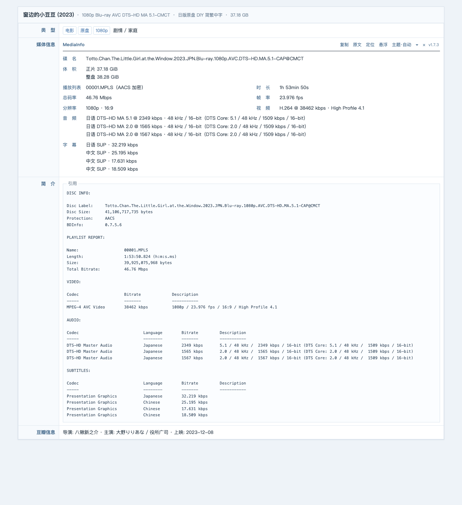

# MediaInfo 媒体信息卡片

把 PT 种子详情页里那一大坨 MediaInfo 英文原文、以及原盘的 BDInfo 碟报，自动整理成和站点同款的「媒体信息」行——一眼看清码率、分辨率、音轨、字幕，还能一键复制成整理好的文本。

适用于 **hdwing.org**（改 `@match` 可换其他 NexusPHP / Unit3D / Gazelle 站点），Tampermonkey / Violentmonkey 均可。



> 上图：原盘 BDInfo 被包在「引用」框里、一行一个 `<div>`、空格写成 `&nbsp;`，卡片照样能读出碟名、体积、播放列表、时长、码率与每条音轨 / 字幕，并作为独立一行落在「简介」上方。

## 它做什么

脚本会自动找到页面上的 MediaInfo 或 BDInfo（**包括 `display:none` 折叠起来的、`<textarea>` 里的、用 `<br>` 逐行排版的、被塞进同源 iframe / shadow root 的**），解析成结构化字段，作为独立一行插在「简介」上方，不必展开简介也能看到：

- **位置**：表格里独立的一行，左侧有和「字幕」「简介」同款的「媒体信息」标签格
- **样式**：没有白底卡片、没有阴影、没有彩色色条，字体 / 字号 / 正文色 / 字段名色 / 分隔线全部从站点自身样式采样，看起来就是站点原生的表格行
- **内容（重编码）**：文件名 / 日期 / 体积 / 时长 / 帧率 / 参数 / 分辨率 / 视频 / 音频 / 字幕
- **内容（原盘 BDInfo）**：碟名 / 标签 / 体积（正片·整盘）/ 播放列表 / 时长 / 总码率 / 帧率 / 分辨率 / 视频 / 音频 / 字幕（原盘只有 `Disc Label` 时，碟名直接用标签值，不会空着）
- 短字段并排、长字段独占一行，列数随可用宽度自适应

## 功能

| 功能 | 说明 |
| --- | --- |
| 自动识别 | 按内容特征打分判断，不依赖具体模板类名；折叠、隐藏、`textarea`、`<br>` 排版都能读取 |
| 两种源都认 | MediaInfo（重编码、WEB-DL）与原盘 BDInfo 碟报都能解析；BDInfo 的「一行一字段短格式」与「DISC INFO / PLAYLIST REPORT / VIDEO / AUDIO / SUBTITLES 分段长格式」都支持，换行被站点吞掉、整段粘成一行也能还原 |
| 单位换算 | `Disc Size` / `Size` 的字节数换算成 GiB 并区分「正片 / 整盘」，`Length` 的 `1:48:56.863` 转成 `1h 48min 56s`，`Protection` 并入播放列表（如 `00001.MPLS（AACS 加密）`） |
| 一键复制 | 输出「文件名／日期／体积／…／字幕」的纯文本（原盘为「碟名／标签／体积／播放列表／…」），可直接贴到论坛或聊天 |
| 融入站点 | 内嵌时从「简介」行采样字体、字号、正文色、次要色、边框色，深色站点自动跟随 |
| 悬浮 / 内嵌 | 默认智能选择，找不到「简介」行则右下角悬浮（可拖拽，位置会记住） |
| 多份切换 | 一页有多份 MediaInfo / BDInfo 时用 `‹ 1/2 ›` 切换 |
| 参数折叠 | 编码参数默认只显示关键项，可展开全部 |
| 字幕折叠 | 字幕超过 5 条时只列出中 / 英文字幕，其余收进「+ 更多（N）」；「复制」与「原文」始终完整 |
| 诊断 | 字段为空时点「复制诊断信息」，一次列出抓到的文本、页面标记与每个字段的解析结果 |
| 快捷键 | `Alt + M` 显示 / 隐藏 |

## 安装

**方式一：从 GitHub 安装（推荐，之后由本仓库更新）**

1. 浏览器装好 [Tampermonkey](https://www.tampermonkey.net/)；
2. 打开 [mediainfo-card.user.js](https://github.com/ljp801005-tech/mediainfo-card/blob/main/mediainfo-card.user.js)，点右上角 **Raw**，油猴会弹出安装页；
   也可以直接用这个地址：`https://raw.githubusercontent.com/ljp801005-tech/mediainfo-card/main/mediainfo-card.user.js`
3. 安装后打开任意种子详情页即可看到「媒体信息」行。

**方式二：从 Greasy Fork 安装**

[greasyfork.org/zh-CN/scripts/605024](https://greasyfork.org/zh-CN/scripts/605024)

> 两条渠道的内容一致，但**更新源跟着安装来源走**：从 GitHub 装的由本仓库 `@updateURL` 更新，从 Greasy Fork 装的由 Greasy Fork 更新。

## 更新机制

脚本元数据里已经写好：

```
// @updateURL    https://raw.githubusercontent.com/ljp801005-tech/mediainfo-card/main/mediainfo-card.user.js
// @downloadURL  https://raw.githubusercontent.com/ljp801005-tech/mediainfo-card/main/mediainfo-card.user.js
```

所以日常发版就是「改文件 → 递增 `@version` → push 到 `main`」：

1. Tampermonkey 默认每 24 小时检查一次更新，也可在扩展面板点「检查脚本更新」；油猴菜单里也有「检查更新」。
2. `raw.githubusercontent.com` 有几分钟 CDN 缓存，刚 push 完立刻检查可能仍拿旧文件，等几分钟再来。
3. 版本号必须递增，否则油猴认为没有更新（`@version` 是唯一判断依据）。

带 tag 的发布（可选，便于留档与直链下载）：

```bash
git tag v1.7.4 && git push origin v1.7.4
```

推送 tag 后 GitHub Actions 会自动创建 Release，并把 `mediainfo-card.user.js` 挂到附件里，可用固定地址下载：
`https://github.com/ljp801005-tech/mediainfo-card/releases/latest/download/mediainfo-card.user.js`

## 适用站点

目前 `@match` 只放行 **hdwing.org**，并且排除 `/edit.php` 与 `/upload.php`（发种 / 编辑页要往输入框里贴原文，卡片会挡表单）。想用于其他 PT 站，改脚本头部的 `@match` 即可：

```
// @match  *://*.hdsky.me/*
// @match  *://kp.m-team.cc/*
// @match  *://*.ourbits.club/*
```

NexusPHP / Unit3D / Gazelle 系的详情页基本可以直接运行。站点容器太特殊时，往 `CONFIG.extraSelectors` 补选择器即可。

## 常用配置

脚本内 `CONFIG` 对象集中了可调项：

| 配置 | 默认 | 说明 |
| --- | --- | --- |
| `mode` | `auto` | `auto` 智能（简介可见则内嵌，折叠则悬浮）/ `float` / `inline` |
| `theme` | `auto` | 自动 / 亮色 / 暗色 |
| `followSiteStyle` | `true` | 内嵌时跟随站点配色 |
| `maxInfo` | `12` | 一页最多处理几份 |
| `paramLimit` | `8` | 「参数」默认显示几项 |
| `subtitleCollapseThreshold` | `5` | 字幕超过几条开始折叠（0 = 关闭） |
| `subtitleKeepLangs` | `['zh','en']` | 折叠时保留的语言组 |
| `excludePaths` | `/edit.php`、`/upload.php` | 不生效的路径 |

## 目录结构

```
mediainfo-card/
├── mediainfo-card.user.js       # 脚本本体（唯一维护源）
├── README.md
├── LICENSE
├── screenshots/                 # 效果图
├── docs/
│   ├── mediainfo-card-发帖说明.md   # 面向论坛发帖的完整说明
│   ├── greasyfork-附加信息.md       # Greasy Fork 的「附加信息」正文
│   ├── greasyfork-发布信息.md       # Greasy Fork 表单字段与发版记录
│   └── 更新流程.md                  # 改代码 → 发版 → 双渠道同步
├── scripts/
│   └── build-gf.mjs             # 生成剥离 GitHub updateURL 的 GF 版
└── .github/workflows/
    ├── ci.yml                   # 语法与元数据校验
    └── release.yml              # push tag 自动建 Release
```

## 开发与发版

```bash
node --check mediainfo-card.user.js     # 语法检查
node scripts/build-gf.mjs               # 需要发 Greasy Fork 时生成 dist 版本
git add -A && git commit -m "feat: xxx" && git push
git tag v1.7.5 && git push origin v1.7.5   # 可选：留档 + Release 附件
```

细节见 [docs/更新流程.md](docs/更新流程.md)。

## 常见问题

**页面上明明有 MediaInfo，却没有卡片？**
点卡片工具栏的「诊断」（没有卡片时从油猴菜单打开「关于 / 版本」→「复制诊断信息」），把内容贴到 [Issues](https://github.com/ljp801005-tech/mediainfo-card/issues)。诊断里会列出可读根节点、页面标记、textarea / pre / iframe 数量与得分最高的容器。

**原盘只有「标签」没有「碟名」？**
BDInfo 0.7.5.x 导出的 `DISC INFO` 只有 `Disc Label`、没有 `Disc Title`，1.7.3 起会用标签值填到碟名行，同一串名字只显示一次。

**改了代码，油猴没提示更新？**
检查 `@version` 是否递增；`raw.githubusercontent.com` 有 CDN 缓存，等几分钟；或直接重新点一次 Raw 安装。

## 更新记录

| 版本 | 说明 |
| --- | --- |
| 1.7.4 | 迁到 GitHub 托管，接入 raw 自动更新（`@updateURL` / `@downloadURL` / `@homepageURL` / `@supportURL`） |
| 1.7.3 | 原盘只有 `Disc Label` 时用它兜底「碟名」，不再留空；诊断一次列出全部字段 |
| 1.7.2 | 修复「识别份数 0、卡片完全不出现」：`&nbsp;` / 全角空格摊平，扫描范围补同源 iframe 与 shadow root，新增整页兜底解析 |
| 1.7.1 | 修复 BDInfo 长格式在换行被吞掉时视频 / 音频 / 字幕全空：按分段标题、表头、行首编解码名还原换行 |
| 1.7.0 | 新增 BDInfo（原盘）解析，支持短格式与分段长格式 |
| 1.6.3 | 「日期」只认 MediaInfo 自己的字段，源里没有就留空，不用种子发布时间顶替 |
| 1.6.2 | 段头识别支持「引用 / 代码 / 原文」等 BBCode 前缀 |
| 1.6.1 | 文件名 / 日期 / 体积的整页兜底；新增「复制诊断信息」 |
| 1.6.0 | 修复 General 段被拆开时文件名 / 体积为空 |
| 1.5.0 | 字幕超过 5 条时折叠小语种 |
| 1.4.x | 内嵌样式融入站点；排除编辑 / 发种页 |
| 1.3.0 | 字段自适应分列 |
| 1.2.0 | 卡片改为独立表格行，放在「简介」上方 |
| 1.1.0 | 适配折叠区块、`<br>` 排版、异步加载与深浅主题 |
| 1.0.0 | 首版 |

## License

[MIT](LICENSE)
